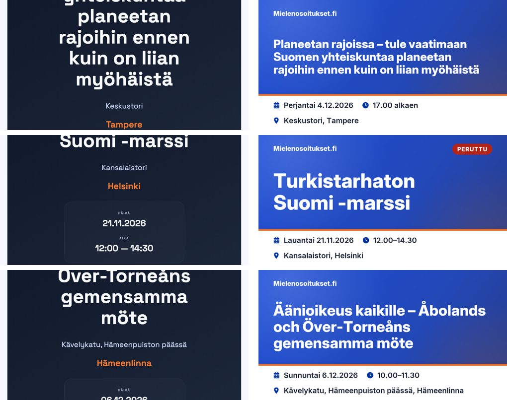
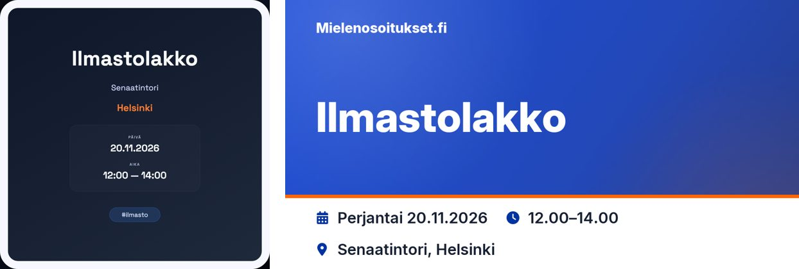
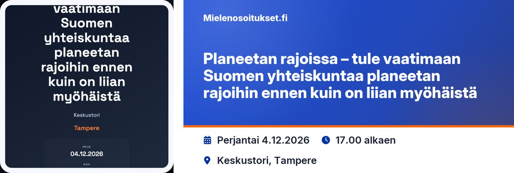
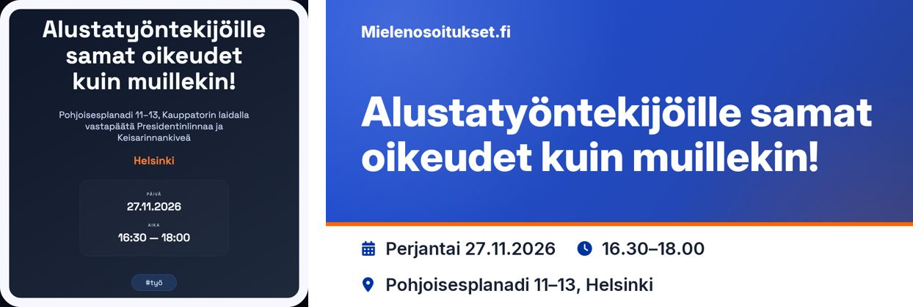
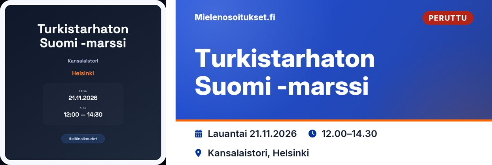
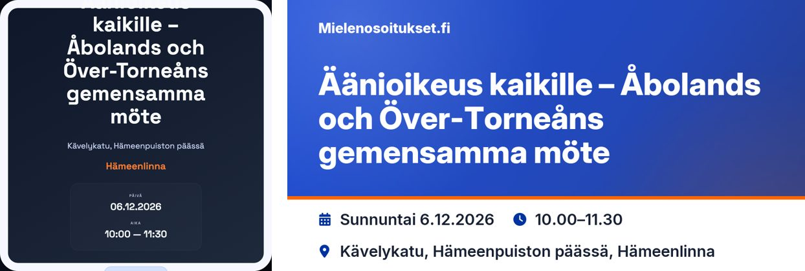
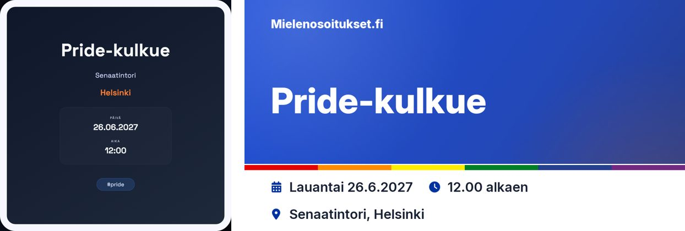

# Social preview images

Every demonstration gets an autogenerated image that social networks and chat
apps show when its page is shared (`og:image` / `twitter:image`). Listing cards
also fall back to it when an event has no cover picture.

## Generation

- Renderer: `mielenosoitukset_fi/utils/preview_image.py` (Pillow). It draws the
  image from the event data with the bundled fonts in
  `mielenosoitukset_fi/static/fonts/inter/` (Inter 4.1, SIL OFL, see `OFL.txt`)
  and the Font Awesome solid font in `static/fa/webfonts/`. No browser, network
  or system font is involved, and the same event always gives the same PNG.
- Callers: `utils/screenshot.py:create_screenshot` (the `/screenshot/<id>`
  fallback and the admin "trigger screenshot" action) and the background job
  `run_preview` (`scripts/preview_image_creator.py`), which uploads new images
  with `upload_image_fileobj(..., "demo_preview")` and stores the CDN URL in
  `preview_image`. The upload converts to JPEG.
- The job only renders events without a `preview_image` unless it runs with
  `force=True`. Changing the design therefore does not touch existing images.

## Design

1200×630, the size that Facebook, X, LinkedIn and messaging apps show uncropped.

| Element | Spec |
|---|---|
| Background | Site hero gradient: `#1d4ed8` → `#2348b8` → `#253b85` at 125°, with the hero's white and orange glows. White text stays at 4.9:1 or more, including on the lighter glow behind the wordmark (all text on it is large, so the WCAG minimum is 3:1) |
| Wordmark | *Mielenosoitukset.fi*, Inter ExtraBold 32px, white, top left |
| Status | Cancelled: `PERUTTU` pill, white on `product-danger` `#b42318` (6.6:1), top right |
| Title | Inter Display ExtraBold, white, left-aligned, the largest of 96→52px that fits three lines; longer titles end at a word with `…` |
| Accent | 8px rule in `product-accent` `#ff6600`; Pride events use 14px Pride stripes under a 3px white hairline, so the blue and violet stripes stay distinct from the hero |
| Information band | `product-surface` white with `product-text` `#172033` (16:1) and `product-primary` `#0033a0` icons: `Perjantai 20.11.2026`, `12.00–14.00` or `13.00 alkaen`, and the place as *address, city*. A long address first drops its trailing comma-separated parts, then is cut with `…`; the city always stays |

Copy follows the design system: Finnish only, written-out weekday, no leading
zeros, the site's dot clock with an en dash. A Finnish open-compound suffix
(`Suomi -marssi`) and a spaced dash stay on the line of the preceding word.

## Extending

All colours and the background live in `PreviewTheme`. A theme's `background`
callable can return any image, so a future organizer-supplied template can
reuse the text layout without changing the renderer.

## Which picture is shown

A picture the organizer uploaded always wins over the generated preview. Event
cards (Go `cardImage` in `go-api/cards.go`, React `imageCandidates`) and the
detail page's `og:image` (`frontend/src/app/detail-route.ts`, `uploadedImage`)
use the first image from `gallery_images`, `images`, `img`, `cover_picture` or
`cover_image` that is not a generated preview. Generated previews are the
`DEM/demo_preview-N` CDN objects and the legacy `/static/demo_preview/` files;
uploads are stored as `DEM/demo_pics-N`. Without an upload, `preview_image` is
used, and without either the site default `og-default.jpg`.

Older events have a generated preview copied into `cover_picture`, which made
cards keep showing an outdated square image. Those copies no longer count as
covers.

## Regenerating existing images

On 11 November 2026, all 638 events were regenerated in production (638 done,
0 failed, 0 skipped). Every upload got a new CDN key, and no old object was
overwritten or deleted. The backups are on the production host in
`/var/backups/mielenosoitukset/`:

- `preview_image_backup_2026-11-11.jsonl`: one line per regenerated event,
  holding its `_id` and its `old` and `new` URLs;
- `image_fields_snapshot_2026-11-11.json`: `preview_image`, `cover_picture`,
  `img` and `cover_source` for every event and recurring series, taken after
  the run;
- copies of `scripts/regenerate_preview_images.py` (the throttled run) and `scripts/restore_preview_images.py`.

To revert, run the restore script. Without `--apply` it is a dry run that only
reports what it would change. It skips any event whose `preview_image` has
changed since the run:

```bash
cd /var/www/mielenosoitukset_fi
sudo -u www-data env PYTHONPATH=. python3 /var/backups/mielenosoitukset/restore_preview_images.py \
  /var/backups/mielenosoitukset/preview_image_backup_2026-11-11.jsonl --apply
```

Cached detail responses refresh within 15 minutes.

## Before and after

Sample events rendered with the old template (left) and the new generator (right).
Production images keep the old design until they are regenerated.









